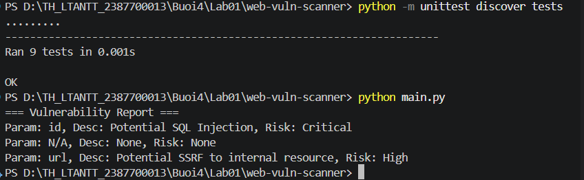
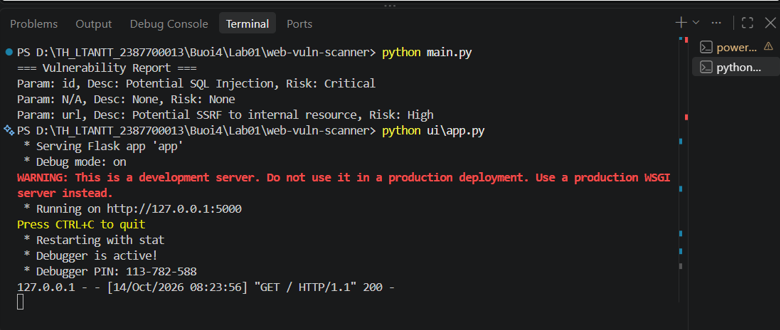
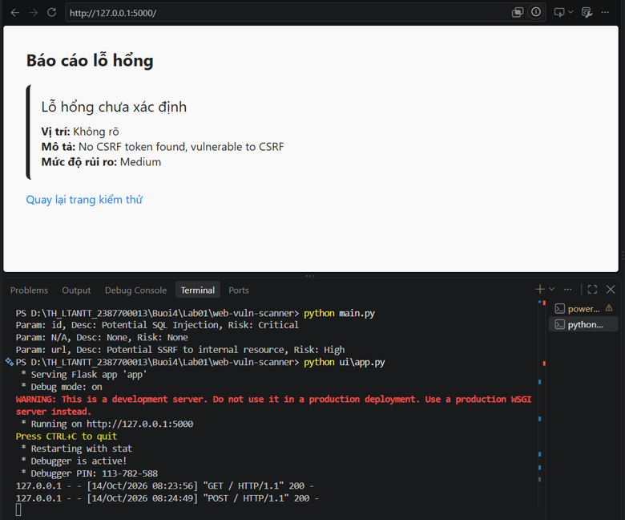

# Web Vulnerability Scanner

Dự án này là một công cụ quét lỗ hổng ứng dụng web tự động, được xây dựng bằng Python và Flask. Công cụ hỗ trợ phát hiện các lỗ hổng phổ biến bao gồm XSS, SQL Injection, CSRF và SSRF.

## Tính năng chính
*   **XSS Scanner:** Phát hiện lỗi Cross-Site Scripting qua payload chuẩn.
*   **SQL Injection Tester:** Kiểm thử các biến thể SQLi trên các tham số URL.
*   **CSRF Detector:** Phân tích mã nguồn HTML để tìm kiếm sự thiếu hụt của token bảo vệ CSRF.
*   **SSRF Tester:** Phát hiện nguy cơ Server-Side Request Forgery truy cập vào IP nội bộ.
*   **Báo cáo (Report):** Tổng hợp và xuất báo cáo mức độ rủi ro chi tiết.

## Cài đặt

1. Đảm bảo bạn đã cài đặt Python 3.
2. Cài đặt các thư viện yêu cầu:
   ```bash
   pip install -r requirements.txt
   ```

## Hướng dẫn sử dụng

### 1. Chạy kiểm thử tự động (Unit Test)
Kiểm tra xem các module quét có hoạt động chính xác hay không:
```bash
python -m unittest discover tests
```
*Kết quả Unit Test:*
<!-- CHÈN ẢNH KẾT QUẢ UNIT TEST VÀO BÊN DƯỚI -->


### 2. Chạy qua giao diện dòng lệnh (CLI)
Chạy kịch bản quét trực tiếp trên terminal:
```bash
python main.py
```
*Kết quả CLI Report:*
<!-- CHÈN ẢNH KẾT QUẢ TERMINAL BÁO CÁO VÀO BÊN DƯỚI -->


### 3. Chạy giao diện Web (UI)
Khởi chạy server Flask để sử dụng giao diện web:
```bash
python ui/app.py
```
Sau đó truy cập `http://127.0.0.1:5000` trên trình duyệt.

*Giao diện trang chủ và Kết quả Web:*
<!-- CHÈN ẢNH GIAO DIỆN WEB VÀ KẾT QUẢ QUÉT VÀO BÊN DƯỚI -->
